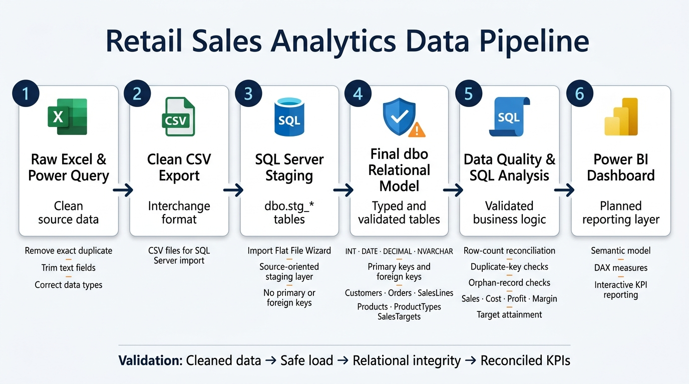

# 🛒 Retail Sales & Profitability Analytics

<p align="center">
  <a href="#data-pipeline">
    
  </a>

  <a href="#excel--power-query">
    
  </a>

  <a href="#sql-server">
    
  </a>

  <a href="#power-bi">
    
  </a>
</p>

<p align="center">
  End-to-end retail analytics project: from raw Excel data to a validated SQL Server model and interactive Power BI reporting.
</p>

<p align="center">
  <a href="screenshots/data-pipeline-overview.jpg">
    
  </a>
</p>

> This project uses synthetic data for educational and portfolio purposes.

---

## Data Pipeline

```text
Raw Excel → Power Query → Clean CSV → SQL Server Staging
→ Final dbo Model → Data Quality Checks → SQL Analysis → Power BI Dashboard
```

This project follows a complete analytics workflow: clean the source data, load it safely into SQL Server, validate the relational model, analyse business performance, and present the results in Power BI.

---

## Excel & Power Query

I used Excel and Power Query to prepare the raw source data for SQL Server.

- Removed exact duplicate records.
- Trimmed and standardized text fields.
- Applied correct data types.
- Converted quantity values to whole numbers.
- Preserved missing values without inventing replacements.
- Exported clean tables to CSV for SQL Server loading.

This stage demonstrates practical data-cleaning and transformation skills before data enters the database.

---

## SQL Server

I built a relational SQL Server model using a staging-to-final-table workflow.

CSV files were imported into staging tables first:

- `stg_Customers`
- `stg_Orders`
- `stg_SalesLines`
- `stg_Products`
- `stg_ProductTypes`
- `stg_SalesTargets`

The staging data was then transformed into validated final `dbo` tables.

```text
Customers (1) ───< Orders (1) ───< SalesLines >─── (1) Products >─── (1) ProductTypes
```

The SQL work includes:

- Creating typed tables with `INT`, `DATE`, `DECIMAL`, and `NVARCHAR`.
- Creating primary keys and foreign keys.
- Loading data through reusable SQL scripts.
- Checking duplicate keys and orphan records.
- Reconciling staging and final row counts.
- Analysing sales, cost, profit, margins, customers, products, discounts, and sales targets.

---

## Power BI

I connected Power BI to the validated SQL Server `dbo` tables and created a semantic model for reporting.

The report includes:

- Executive KPI overview.
- Sales and profit trends by month.
- Product and category profitability analysis.
- Regional sales-target attainment.
- Customer and repeat-purchase analysis.
- Interactive filtering by date, region, product category, and customer segment.

The report uses DAX measures for:

- Total Sales
- Total Cost
- Total Profit
- Profit Margin
- Average Order Value
- Target Attainment

---

## Skills Demonstrated

- Data cleaning with Excel and Power Query.
- SQL Server staging and relational data modeling.
- Primary key and foreign key implementation.
- SQL data-quality validation.
- Business analysis with SQL.
- Power BI data modeling and DAX.
- Interactive dashboard design.
- Clear technical documentation with GitHub.

---

## Repository Structure

```text
retail-sales-profitability-analytics/
│
├── docs/
│   ├── data_dictionary.md
│   └── data_quality_log.md
│
├── excel/
│   ├── Retail_Sales_Analytics_Raw.xlsx
│   └── Retail_Sales_Analytics_Clean.xlsx
│
├── screenshots/
│   └── data-pipeline-overview.jpg
│
├── sql/
│   ├── 00_staging_import.md
│   ├── 01_create_final_tables.sql
│   ├── 02_load_from_staging.sql
│   ├── 03_data_quality_checks.sql
│   └── 04_profitability_analysis.sql
│
└── README.md
```
