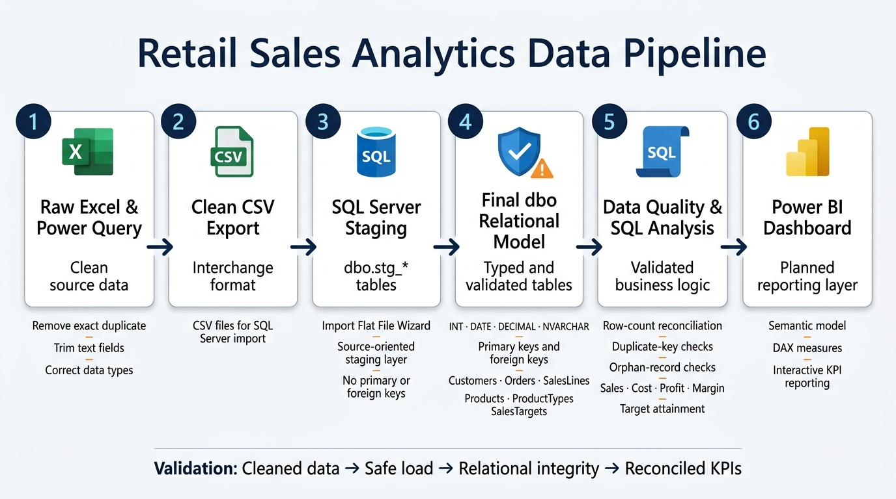
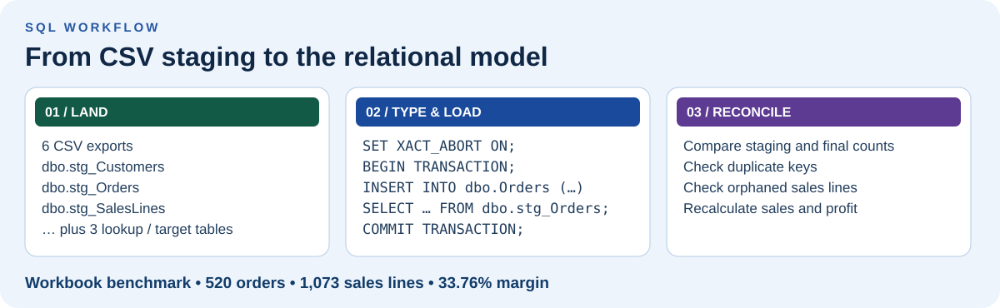
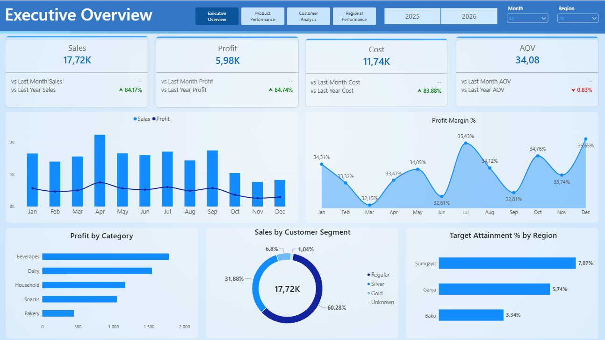
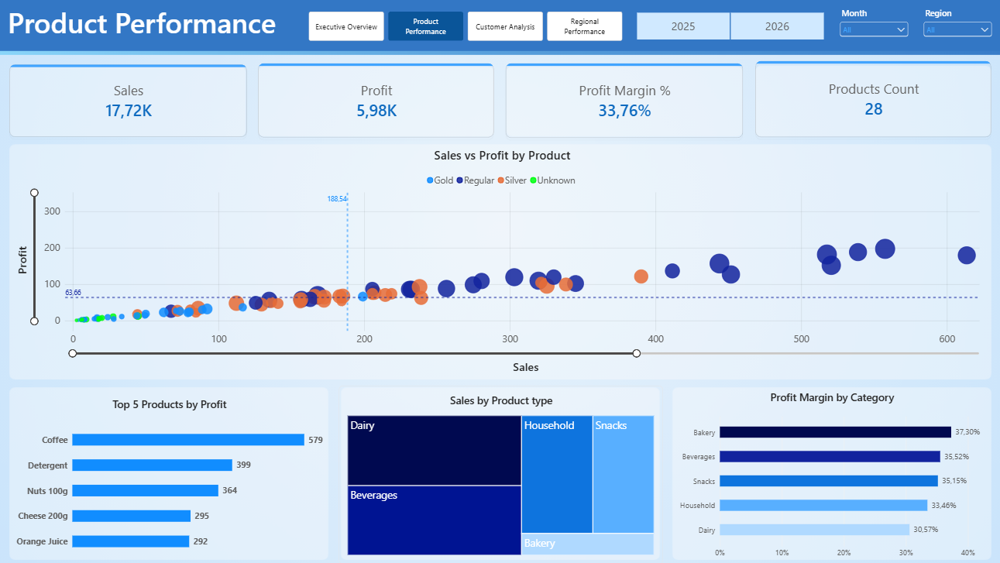
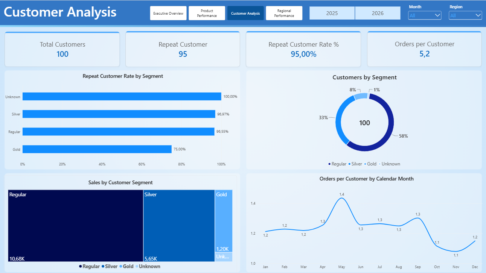
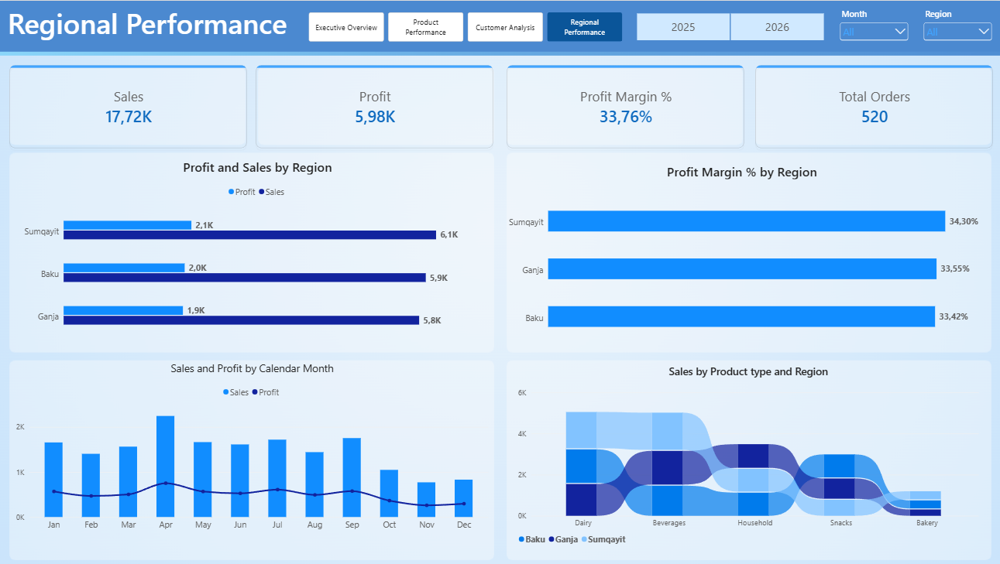
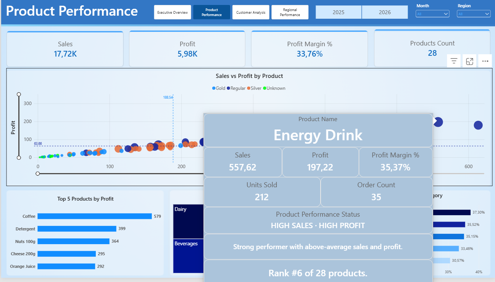
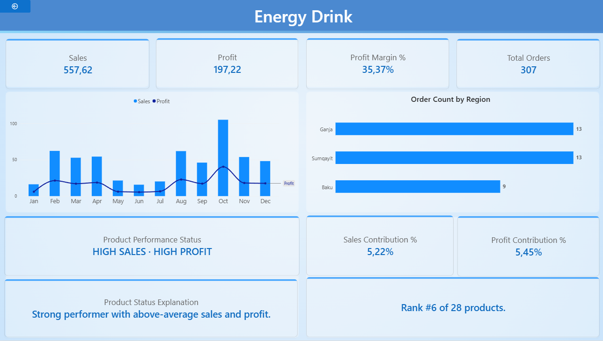

# Retail Sales & Profitability Analytics

  

[Pipeline](#data-pipeline) · [SQL walkthrough](#sql-walkthrough) · [Report screenshots](#report-screenshots) · [Results](#what-the-data-shows)

An end-to-end retail analytics project that uses Excel, Power Query, SQL Server, and Power BI to answer where sales come from, which products generate profit, and how customer behavior varies across segments and regions.

[Download the Power BI report](power-bi/Retail_Sales_Analytics.pbix) · [SQL setup](sql/00_staging_import.md) · [Data dictionary](docs/data_dictionary.md) · [Data quality log](docs/data_quality_log.md)

The dataset is synthetic and intended for portfolio and learning use. It contains 520 orders, 1,073 sales lines, 28 products, 100 customer records, and three regions.

## Data pipeline

[](screenshots/data-pipeline-overview.jpg)

## SQL walkthrough



| Stage | What happens | Why it matters |
| --- | --- | --- |
| 📥 Land six CSVs | The SQL Server Import Flat File Wizard creates `dbo.stg_*` tables from the cleaned Excel exports. | Imported values stay available for inspection before conversion. |
| 🧱 Create the final schema | `Customers` and `ProductTypes` define lookups. `Orders` links to customers, `Products` links to types, and `SalesLines` links orders to products. Targets are stored by month and region. | Each table has a clear grain. Foreign keys prevent sales lines from pointing to missing orders or products. |
| 🔄 Load in dependency order | The load trims text, parses dates and standardizes decimal separators inside a transaction with `XACT_ABORT ON`. | If a conversion or constraint fails, the transaction avoids leaving a partially loaded model. |
| ✅ Reconcile | The quality script compares staging and final counts and returns any duplicate keys or unmatched relationships. | A matching row count alone can hide broken joins. The key checks catch those separately. |

The order load shows how the staging layer separates imported strings from typed reporting columns.

```sql
INSERT INTO dbo.Orders (OrderID, OrderDate, CustomerID, Region)
SELECT TRY_CONVERT(INT, OrderID),
       TRY_CONVERT(DATE, OrderDate, 104),
       TRY_CONVERT(INT, CustomerID),
       LTRIM(RTRIM(Region))
FROM dbo.stg_Orders;
```

[Import instructions](sql/00_staging_import.md) · [Final schema](sql/01_create_final_tables.sql) · [Full load](sql/02_load_from_staging.sql) · [Quality checks](sql/03_data_quality_checks.sql)

The analytical SQL joins sales lines to product costs, calculates margin from aggregated profit and sales, and compares actual sales against targets at the same month and region grain. This gives a benchmark for the dashboard KPIs and avoids joining one monthly target to every transaction.

## Explore the report

Download the PBIX and open it in Power BI Desktop. Use the saved data to explore the report before refreshing. Use the page navigator and date and region filters to compare results.

| Page | What to explore |
| --- | --- |
| Executive Overview | Sales, cost, profit and average order value, with trends and period comparisons |
| Product Performance | Product and category performance and a scatter plot comparing sales with profit |
| Customer Analysis | Customer segments, repeat purchases and orders per customer |
| Regional Performance | Compare Baku, Ganja and Sumqayit by sales, profit, margin and product mix |

On the product scatter plot, hover over a point for the product tooltip, or right-click and choose **Drill through → Product Details** for a deeper view. Both pages are hidden from the main navigator.

## Report screenshots

### Executive Overview



### Product Performance



### Customer Analysis



### Regional Performance



### Product tooltip and drill-through

Hover over the highlighted point to see the Energy Drink tooltip.



Open **Product Details** from the same point to see its monthly performance, orders by region, contribution and rank.



## What the data shows

These full-dataset benchmarks were independently calculated from the cleaned Excel workbook. Clear the report filters before comparing totals.

| Region | Net sales | Gross profit | Gross margin |
| --- | ---: | ---: | ---: |
| Sumqayit | 6,055.14 | 2,076.94 | 34.30% |
| Baku | 5,887.48 | 1,967.62 | 33.42% |
| Ganja | 5,779.95 | 1,939.10 | 33.55% |
| **Total** | **17,722.57** | **5,983.67** | **33.76%** |

Sumqayit leads on sales, profit and margin. Baku sells more than Ganja but has a lower margin, so sales volume alone gives a different picture of regional performance.

Net sales equal quantity × transaction unit price × (1 − discount). Gross profit subtracts quantity × product unit cost from net sales. Gross margin divides gross profit by net sales. The margin reflects product cost and discounts in the dataset.

## Reproduce the analysis

1. Start with the [raw Excel workbook](excel/Retail_Sales_Analytics_Raw.xlsx), or use the [cleaned workbook](excel/Retail_Sales_Analytics_Clean.xlsx) as the input to SQL Server. The [data quality log](docs/data_quality_log.md) documents duplicate handling, text and date normalization, and how the missing segment was represented.
2. Create a fresh SQL Server database and follow the [staging import instructions](sql/00_staging_import.md). Run scripts 01–04 in order to create and load the final schema, check it, and generate the analytical outputs.
3. Compare the first result from [the profitability query](sql/04_profitability_analysis.sql) with the benchmarks above. The query file also contains category and regional target analysis.
4. To refresh the PBIX against your own environment, inspect its queries in **Transform data** and update their source connections to your local data. Set credentials in **Data source settings**, then refresh and reconcile totals. Source paths and credentials depend on your setup.

```text
Raw Excel → Power Query → Clean Excel → CSV staging → SQL Server → Power BI
```
